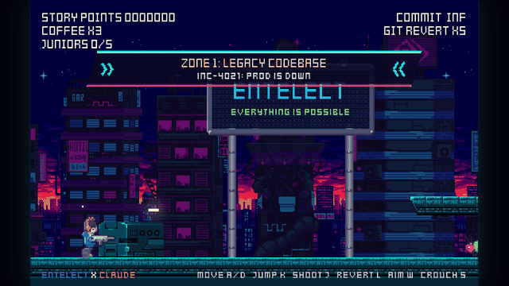
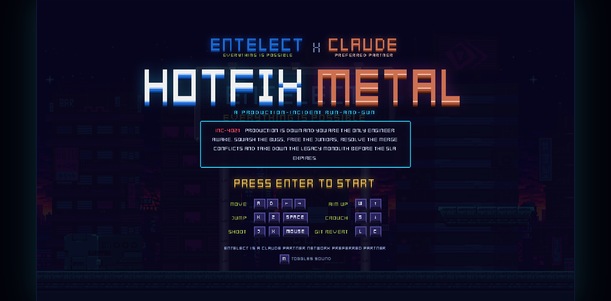
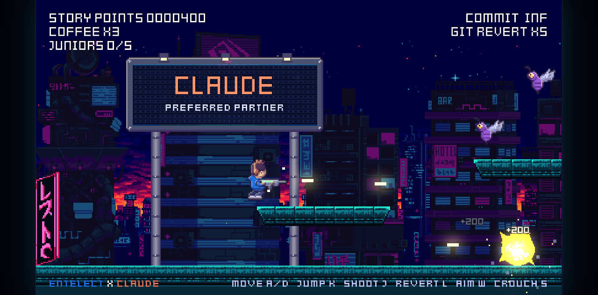
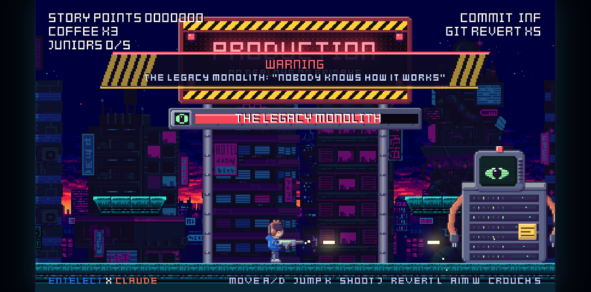
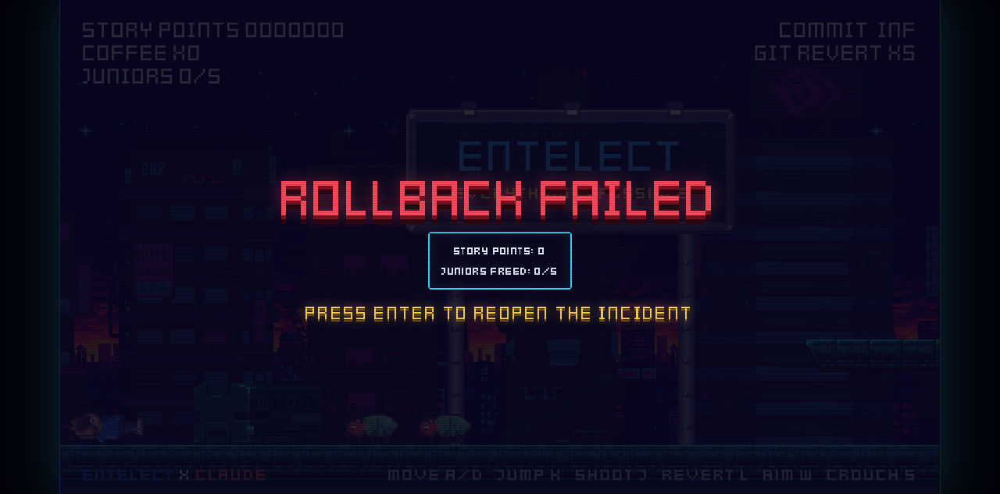

<div align="center">

# HOTFIX METAL

**A production-incident run-and-gun. Entelect × Claude.**

<a href="https://devilears.github.io/hotfix-metal/"></a>

### [▶ Play in your browser](https://devilears.github.io/hotfix-metal/)

[](https://devilears.github.io/hotfix-metal/)
[](https://forge-game-engine.github.io/Forge/)


</div>

---

> **INC-4021: production is down and you're the only engineer awake.**
> Blast your way through the bugs, rogue cron bots and heisenbugs of a neon city. Free the junior devs tied up in ethernet cable. Resolve the merge conflicts. Then take down **the Legacy Monolith**, a 15-year-old mainframe nobody dares to touch, before the SLA expires.

## Screenshots

<table>
  <tr>
    <td width="50%"><br><sub><b>Title screen.</b> Neon pixel lettering, keycap controls.</sub></td>
    <td width="50%"><br><sub><b>Zone 2: Merge Conflict Canyon.</b> Cron bots, heisenbugs and rooftop platforms.</sub></td>
  </tr>
  <tr>
    <td width="50%"><br><sub><b>Production.</b> The Legacy Monolith wakes up.</sub></td>
    <td width="50%"><br><sub><b>Rollback failed.</b> Reopen the incident and try again.</sub></td>
  </tr>
</table>

## Features

- **Metal Slug-style run-and-gun.** Run, jump, crouch, aim up, shoot and lob `git revert` grenades.
- **Three zones and a boss.** Legacy Codebase, Merge Conflict Canyon and Production, then a two-phase fight with the Legacy Monolith.
- **Hostage rescues.** Free five junior devs for power-ups: Heavy Commit, Claude Assist spread shot, extra reverts and coffee (lives).
- **A living neon city.** Three-layer parallax skyline, LED billboards on poles, flickering neon tubes, a hanging lightbox and hazard signage.
- **Hand-tuned procedural pixel art.** The whole cast is drawn in code with shading ramps, posed limbs and selective outlines.
- **Arcade presentation.** Pixel fonts throughout, a slanted announcement banner, a framed boss bar, bloom and screen shake.

## Controls

| Action | Keys |
|---|---|
| Move | <kbd>A</kbd> <kbd>D</kbd> or <kbd>←</kbd> <kbd>→</kbd> |
| Jump | <kbd>K</kbd> <kbd>Z</kbd> or <kbd>Space</kbd> |
| Shoot | <kbd>J</kbd> <kbd>X</kbd> or left mouse |
| Git revert (grenade) | <kbd>L</kbd> <kbd>C</kbd> |
| Aim up | <kbd>W</kbd> or <kbd>↑</kbd> |
| Crouch | <kbd>S</kbd> or <kbd>↓</kbd> |
| Start / restart | <kbd>Enter</kbd> |
| Mute | <kbd>M</kbd> |

## Run it locally

```bash
npm install
npm run dev          # http://localhost:5173
npm run build        # production build in dist/
npm run preview      # serve dist/
npm run typecheck
```

Jump straight to a section with `?start=zone2`, `?start=zone3` or `?start=boss`.

## How it's made

HOTFIX METAL runs on the [Forge game engine](https://forge-game-engine.github.io/Forge/) (TypeScript, ECS, WebGL2): sprite animation, sensor colliders, particles, bloom, audio and MSDF text. The platformer movement is a custom kinematic controller.

Every asset is generated by a script, so the look can be tuned in code. `npm run assets` regenerates them all (needs Python with Pillow, numpy and scipy):

| Script | What it makes |
|---|---|
| `scripts/import_env.py` | City backdrop, street tiles, props and explosion from the CC0 Warped City pack |
| `scripts/make_art.py` + `scripts/pixel.py` | The character cast, neon signs and HUD panels, with shaded parts, posed limbs and selective outlines |
| `scripts/make_fonts.py` | Converts the CC0 Kenney pixel fonts into Forge font atlases (signed distance fields) |
| `scripts/make_audio.py` | Original chiptune music and sound effects |
| `scripts/preview_sheets.py` | A 4× contact sheet of every sprite sheet, for reviewing art |
| `scripts/screenshots.mjs` | `npm run screenshots`: the README images and GIF, captured with headless Chrome |

<details>
<summary><b>Project layout</b></summary>

- `src/game.ts`: world, cameras, input, system registration order
- `src/level.ts`: platforms and the spawn script
- `src/systems/`: player, enemies and boss, projectiles and pickups, collisions, combat, camera, flow, sign flicker
- `src/spawn.ts`: entity factories
- `src/hud.ts`: HUD, announcement banner, boss bar
- `src/world.ts`: backdrop, ground, props, billboards
- `src/text.ts`: pixel-snapped text sizes and shadows
- `third_party/`: the CC0 source packs, with their licenses

</details>

## Credits & licenses

- **Environment art:** [Warped City](https://opengameart.org/content/warped-city) by Luis Zuno ([@ansimuz](https://ansimuz.com)), CC0 / public domain.
- **Fonts:** [Kenney Fonts](https://kenney.nl/assets/kenney-fonts) by Kenney, CC0 / public domain.
- **Engine:** [Forge](https://forge-game-engine.github.io/Forge/) by Storm Muller, MIT (vendored in `vendor/forge`).
- **Characters, signs, HUD, music and sound effects:** original, made for this project.

## Branding

Brand config lives in `src/brand.ts` (colours, tagline, names). Official logos are **not** bundled: drop `entelect-logo.png` and `claude-logo.png` into `public/brand/` and they replace the text wordmarks automatically.
The colours are approximations: Entelect blue `#1e6fe0`, lime `#a5c249`, Claude coral `#d97757`. Confirm Entelect brand approval and the Claude Partner Network co-marketing guidelines before any external use.

<details>
<summary><b>Hosting on GitHub Pages</b></summary>

The build is fully static (`base: './'`), so it works from a project subpath.

1. Push this folder to a GitHub repo, including `vendor/forge`. `.gitignore` only excludes `/dist` and `node_modules`.
2. In the repo, go to Settings → Pages → Source and choose **GitHub Actions**.
3. Push to `main`. `.github/workflows/pages.yml` builds and deploys the site to `https://<user>.github.io/<repo>/`.

</details>

<details>
<summary><b>Forge dependency</b></summary>

Forge is published on GitHub Packages, which needs a personal access token. To keep this project installable offline, a built copy lives in `vendor/forge`, and `package.json` points to it (`file:vendor/forge`).
To use the registry version instead, add an `.npmrc` with the `@forge-game-engine` scope and your PAT, then change the dependency to the published version.

</details>

<details>
<summary><b>Feasibility notes</b></summary>

Forge is a good fit for a 2D run-and-gun: ECS, sprite animation, sensor colliders, particles, bloom, audio and MSDF text are all there.
Gaps: there's no built-in platformer physics (this game uses a custom kinematic controller) and no tilemap or level editor, and the engine is pre-1.0, so APIs may change.
Alternatives: Phaser 3 (largest ecosystem, built-in Arcade physics), Excalibur.js (TypeScript, platformer-friendly), Godot 4 with web export (editor, tilemaps, animation tooling).

</details>
